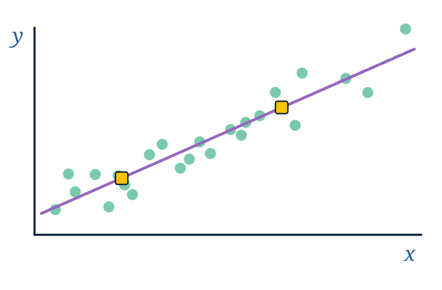

<h1 class="home-title">STT-2902</h1>

Modélisation statistique · Baccalauréat en enseignement au secondaire, mathématiques

Régression linéaire simple, analyse de variance à un facteur et tableaux de contingence, revus à partir de ce que vous enseignerez au secondaire : droites de Mayer et médiane-médiane, coefficient de corrélation, interpolation et extrapolation, comparaison de distributions et probabilités conditionnelles.

<a class="home-action home-action--primary" href="plan-de-cours.html">Plan de cours</a>
<a class="home-action home-action--secondary" href="calendrier.html">Calendrier</a>
<a class="home-action home-action--secondary" href="secondaire.html">Du secondaire à la théorie</a>

